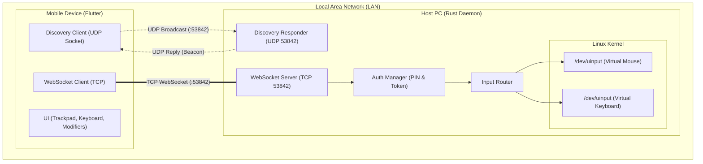
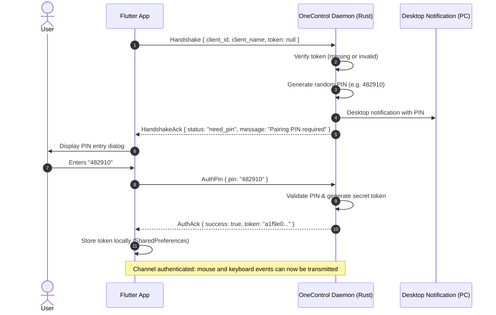

# Architecture & Protocol: OneControl

OneControl is a modular, low-latency, cross-platform solution for remote keyboard and mouse control over LAN from a smartphone (Android/iOS) to a host PC.

---

## 1. System Topology



---

## 2. Local Network Auto-Discovery (UDP)

- **Port**: `53842` (UDP)
- **Client Request**:
  The Flutter client broadcasts to `255.255.255.255:53842`:
  ```json
  {
    "magic": "ONECONTROL_DISCOVERY"
  }
  ```
- **Server Response**:
  The daemon replies directly to the source IP (or sends periodic beacons):
  ```json
  {
    "magic": "ONECONTROL_BEACON",
    "hostname": "arch-desktop",
    "port": 53842,
    "os": "linux",
    "version": "0.1.0"
  }
  ```

---

## 3. Connection & Authentication Protocol (WebSocket)

The primary data stream runs over WebSocket on **TCP 53842** with the `TCP_NODELAY` flag enabled to reduce latency to < 2 ms.

### 3.1 Handshake & PIN Pairing Flow (Initial Pairing)



On subsequent connections, the app includes the saved token:
```json
{
  "type": "handshake",
  "client_id": "client_102948",
  "client_name": "Fabrizio's Phone",
  "token": "a1f9e0...",
  "locale": "it"
}
```
The server validates the token stored in `~/.config/onecontrol/authorized_clients.json` and immediately replies with `status: "authenticated"`.

---

## 4. Input Message Specifications

All messages are JSON objects serialized across WebSocket text frames:

### 4.1 Relative Mouse Movement
```json
{
  "type": "mouse_move",
  "dx": 12,
  "dy": -8
}
```

### 4.2 Mouse Buttons
```json
{
  "type": "mouse_button",
  "button": "left",
  "action": "click"
}
```
Supported values:
- `button`: `"left"`, `"right"`, `"middle"`
- `action`: `"press"`, `"release"`, `"click"`

### 4.3 Mouse Scroll (Wheel)
```json
{
  "type": "mouse_scroll",
  "dx": 0,
  "dy": 1
}
```

### 4.4 Key Events
```json
{
  "type": "key_event",
  "key": "CTRL",
  "action": "down"
}
```
Supported values:
- `key`: `"CTRL"`, `"SUPER"`, `"ALT"`, `"SHIFT"`, `"TAB"`, `"ESC"`, `"ENTER"`, `"BACKSPACE"`, `"STAMP"`, `"F1"`..`"F12"`, `"UP"`, `"DOWN"`, `"LEFT"`, `"RIGHT"`, `"MUTE"`, `"VOLUP"`, `"VOLDOWN"`, `"PLAYPAUSE"`.
- `action`: `"down"`, `"up"`, `"press"`.

### 4.5 Text Input (Bulk Typing)
```json
{
  "type": "text_input",
  "text": "Hello World!"
}
```

---

## 5. Kernel Input Drivers (`/dev/uinput`)

On Linux (supporting both Wayland and X11 sessions natively), the daemon initializes two virtual HID devices via `/dev/uinput`:
1. **OneControl Virtual Mouse**:
   - `EV_REL`: `REL_X`, `REL_Y`, `REL_WHEEL`, `REL_HWHEEL`.
   - `EV_KEY`: `BTN_LEFT`, `BTN_RIGHT`, `BTN_MIDDLE`, `BTN_SIDE`, `BTN_EXTRA`.
2. **OneControl Virtual Keyboard**:
   - `EV_KEY`: Full Linux kernel keycode set (`KEY_A`-`KEY_Z`, `KEY_0`-`KEY_9`, function keys `F1`-`F12`, modifier and multimedia keys).

### Safety Cleanup
Whenever a client disconnects or the daemon shuts down, `backend.release_all()` is executed automatically, immediately releasing any currently depressed keys or mouse buttons to prevent sticky keys.

---

## 6. Internationalization & Localization Architecture (i18n)

OneControl provides native bilingual support (**English** and **Italian**), automatically detected based on the operating system locale on both platforms:

### 6.1 Android Client (Flutter)
- Conforms to standard Flutter internationalization (`flutter_localizations`, `GlobalMaterialLocalizations`, `GlobalWidgetsLocalizations`, `GlobalCupertinoLocalizations`).
- `supportedLocales`: `[Locale('en'), Locale('it')]`.
- `localeListResolutionCallback`: Resolves the active locale from the Android system preferences; if the system language starts with `it`, Italian is selected; otherwise, English is the fallback.
- Client passes `locale` (`"it"` or `"en"`) in the `Handshake` payload to synchronize server responses with the client's UI language.

### 6.2 Host Daemon (Rust)
- Detects the host Linux desktop language using standard POSIX environment variables: `LC_ALL` $\to$ `LC_MESSAGES` $\to$ `LANG`.
- Desktop DBus PIN notifications are rendered in the host OS language.
- Handshake and auth acknowledgment responses are rendered in the client's negotiated locale.

### 6.3 Management CLI (`./onecontrol`)
- Automatically detects the user's terminal locale via POSIX variables (`LC_ALL`, `LC_MESSAGES`, `LANG`).
- Supports explicit override via the `ONECONTROL_LANG` environment variable (e.g. `ONECONTROL_LANG=it ./onecontrol doctor` or `ONECONTROL_LANG=en ./onecontrol doctor`).

